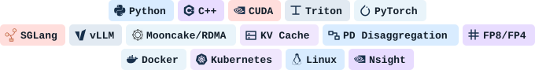

<picture>
  <source media="(max-width: 600px) and (prefers-color-scheme: dark)" srcset="assets/studio/lite-hero-mobile-dark.svg" />
  <source media="(max-width: 600px)" srcset="assets/studio/lite-hero-mobile-light.svg" />
  <source media="(prefers-color-scheme: dark)" srcset="assets/studio/lite-hero-dark.svg" />
  
</picture>

   
  
  
  
  
  

## <samp>Selected Work</samp>

  
  
  
  

Copyable text

- [Mooncake](https://github.com/kvcache-ai/Mooncake) — process-group collectives and expert-parallel dispatch using C++ and RDMA.
- [NVFP4-DiT](https://github.com/theraihanrakibb/nvfp4-dit) — 4-bit audio-guided video diffusion.
- [AI Infrastructure](https://github.com/theraihanrakibb/ai-infra-portfolio) — ten Dockerized services with reproducible quickstarts and CI.
- [Deepfake Detection](https://github.com/theraihanrakibb/deepfake-av-detector) — M.E. thesis on audio, video, and temporal inconsistencies.

## <samp>Tech Stack</samp>

  <picture>
    <source media="(max-width: 1000px)" srcset="assets/studio/tech-stack-narrow.svg" />
    
  </picture>

## <samp>Research & Experience</samp>

  
  

<samp>Collaborations</samp>

  
  

Copyable text

- [SJTU ReArch Lab](https://github.com/SJTU-ReArch-Group) · Research Intern. I develop CUDA and Triton inference kernels and work on FP8 and FP4 KV-cache compression.
- [Approaching.AI](https://approaching-ai.com/en/) · Distributed Inference R&D Intern. I work on [Mooncake](https://github.com/kvcache-ai/Mooncake) and agent RL, in collaboration with [Tsinghua MADSys](https://madsys.cs.tsinghua.edu.cn/).
- Collaborations · [Tsinghua MADSys](https://madsys.cs.tsinghua.edu.cn/) · [KVCache.AI](https://kvcache.ai/).

## <samp>Selected Results</samp>

  
  

Copyable text

- [Mooncake](https://github.com/kvcache-ai/Mooncake) · 55 s → 6.7 s time to first token at a 92% KV-cache hit rate with three-tier offloading over RDMA on four NVIDIA A800 GPUs (80 GB each).
- [NVFP4-DiT](https://github.com/theraihanrakibb/nvfp4-dit) · FP4-packed Triton kernels achieved 3.2× the speed and used one-quarter of the memory compared with FP16. The paper is under review at IEEE TNNLS.

## <samp>Education</samp>

  
  

Copyable text

[**Northwestern Polytechnical University**](https://en.nwpu.edu.cn/) · Xi’an, China  
**M.E. in Software Engineering** · 2024–2027  
Rank **2/87** · GPA 88/100 · Chinese Government Scholarship

[**Northwestern Polytechnical University**](https://en.nwpu.edu.cn/) · Xi’an, China  
**B.E. in Computer Science** · 2020–2024  
Rank **5/56** · GPA 85/100 · Outstanding Graduate · Presidential Scholarship

---

### <samp>More Projects</samp>

  
  
  
  

Copyable text

- [LLM Gateway](https://github.com/theraihanrakibb/llm-gateway) · Routing
- [Mini LLM Serve](https://github.com/theraihanrakibb/mini-llm-serve) · Serving
- [LLM Benchmark](https://github.com/theraihanrakibb/llm-benchmark) · Benchmarking
- [KV Cache Simulator](https://github.com/theraihanrakibb/kv-cache-simulator) · Cache optimization

## <samp>Activity</samp>

<a href="https://github.com/theraihanrakibb#contribution-activity">
  <picture>
    <source media="(prefers-color-scheme: dark)" srcset="assets/studio/activity-lite-dark.svg" />
    
  </picture>
</a>
