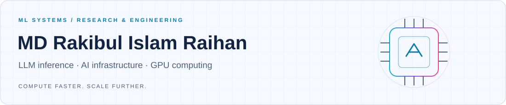

<picture>
  <source media="(prefers-color-scheme: dark)" srcset="assets/header-dark.svg" />
  <source media="(prefers-color-scheme: light)" srcset="assets/header-light.svg" />
  
</picture>

<picture>
  <source media="(prefers-color-scheme: dark)" srcset="https://readme-typing-svg.demolab.com?font=Fira+Code&amp;weight=600&amp;size=19&amp;pause=1600&amp;color=67E8F9&amp;center=true&amp;vCenter=true&amp;width=650&amp;lines=LLM+Inference+%C2%B7+Distributed+Systems;GPU+Kernels+%C2%B7+Low-bit+Computing;Building+systems+for+long-context+agents" />
  <source media="(prefers-color-scheme: light)" srcset="https://readme-typing-svg.demolab.com?font=Fira+Code&amp;weight=600&amp;size=19&amp;pause=1600&amp;color=087EAB&amp;center=true&amp;vCenter=true&amp;width=650&amp;lines=LLM+Inference+%C2%B7+Distributed+Systems;GPU+Kernels+%C2%B7+Low-bit+Computing;Building+systems+for+long-context+agents" />
  
</picture>

 

  
  
  
  

## 🔬 Research

I work on **machine learning systems (MLSys)**, connecting LLM inference—disaggregated serving, KV-cache offloading, and RDMA—with the memory demands of **agentic reinforcement learning**. My goal is to make long-context agent rollouts cheaper and more scalable.

> **8.3× lower TTFT** (55 s to 6.7 s) at **92% KV-cache hit** with three-tier offload over Mooncake RDMA on 4× A800-80GB.

## 🌙 Featured work

### 🌙 Mooncake PG-EP

Contributing process-group collectives and expert-parallel dispatch to [kvcache-ai/Mooncake](https://github.com/kvcache-ai/Mooncake).

## ⚡ Currently

| Role | Where | Work |
|------|-------|------|
| 🔬 **Large Model Inference Distributed System R&D Intern** | Approaching.AI · Tsinghua MADSys collaboration · Nov 2026 to present | Core Mooncake work for agent RL rollouts: the C++ transfer engine over RDMA and KV-cache offloading |
| 🔬 **Research Intern** | SJTU ReArch Lab · Nov 2026 to present | Low-bit inference kernels in CUDA/Triton and FP8/FP4 KV-cache compression |

## 🚀 Selected projects

| Project | Details |
|---------|---------|
| **[NVFP4-DiT](https://github.com/theraihanrakibb/nvfp4-dit)** | 4-bit audio-guided video diffusion. FP4-packed Triton kernels are 3.2× faster than FP16 and use 4× less memory. IEEE TNNLS, under review. |
| **[AI Infrastructure Portfolio](https://github.com/theraihanrakibb/ai-infra-portfolio)** | Ten Dockerized AI-infra services with CI and reproducible quickstarts. |
| **[Multimodal Deepfake Detection](https://github.com/theraihanrakibb/deepfake-av-detector)** | M.E. thesis: audio-visual-temporal framework for deepfake video detection. |
| **[Confidential Spark Queries](https://github.com/theraihanrakibb/spark-ckks-query)** | B.E. thesis: distributed confidential query protocol with CKKS homomorphic encryption. |
| **[Distributed Training Launcher](https://github.com/theraihanrakibb/train-launcher)** | Fault-tolerant multi-node PyTorch launcher with retry and checkpoint recovery. |

## 🛠 Tech stack

 

 

## 🎓 Education

**Northwestern Polytechnical University · Xi'an, China**

| Degree | Details |
|--------|---------|
| **M.E. Software Engineering** | **2024–2027. GPA 88/100 · Rank 2/87 · Chinese Government Scholarship.** |
| **B.E. Computer Science** | **2020–2024. GPA 85/100 · Rank 5/56 · Outstanding Graduate · Presidential Scholarship.** |

## 📈 Activity

View contribution activity

  Actions speak louder than words.

