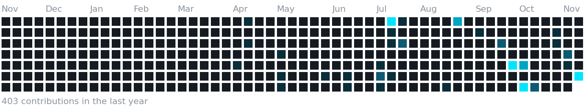

<h1>MD Rakibul Islam Raihan</h1>

  
  &nbsp;
  
  &nbsp;
  
  &nbsp;
  
  &nbsp;
  

  
  
  

---

LLM inference and GPU systems engineer. I build serving systems around KV-cache offloading, prefill/decode disaggregation, and low-precision kernels. At InfiX.ai I cut long-context time to first token 8.3× (55 s to 6.7 s) at a 92% cache hit rate with three-tier KV-cache offload over Mooncake RDMA on 4× A800.

<b>Open to ML Systems / LLM Inference Engineering roles from Jul 2027.</b>

---

### At a glance

| | |
|---|---|
| 🎯 **Focus** | LLM inference systems: KV-cache offload, PD disaggregation, FP8/FP4 low precision |
| 📈 **Headline result** | **8.3× TTFT** (55 s → 6.7 s) at **92%** KV-cache hit, on 4× A800-80GB |
| 🔬 **Research** | First author, **NVFP4-DiT**: 4× less memory, **3.2× faster than FP16** (IEEE TNNLS, under review) |
| 🎓 **Status** | M.E. Software Engineering, Northwestern Polytechnical University · 2027 New Grad |

### Now

- 🔬 **Large Model Inference Distributed System R&D Intern**, Approaching.AI (Tsinghua MADSys collaboration), Nov 2026 to present. Core Mooncake development: C++ transfer engine over RDMA, KV-cache offloading for agent RL rollouts.
- 🔬 **Research Intern**, SJTU ReArch Lab, Nov 2026 to present. Low-bit inference kernels in CUDA/Triton, FP8/FP4 KV-cache compression.

---

### Selected work

| Project | What it does |
|---------|--------------|
| [NVFP4-DiT](https://github.com/theraihanrakibb/nvfp4-dit) | 4-bit audio-guided video diffusion. FP4-packed Triton kernels are 3.2× faster than FP16 and use 4× less memory. IEEE TNNLS, under review. |
| [AI Infrastructure Portfolio](https://github.com/theraihanrakibb/ai-infra-portfolio) | Ten Dockerized AI-infra services with CI and reproducible quickstarts. |
| [Multimodal Deepfake Detection](https://github.com/theraihanrakibb/deepfake-av-detector) | M.E. thesis: audio-visual-temporal framework for deepfake video detection. |
| [Confidential Spark Queries](https://github.com/theraihanrakibb/spark-ckks-query) | B.E. thesis: distributed confidential query protocol with CKKS homomorphic encryption. |
| [Distributed Training Launcher](https://github.com/theraihanrakibb/train-launcher) | Fault-tolerant multi-node PyTorch launcher with retry and checkpoint recovery. |

  
  &nbsp;
  

---

### Tech stack

  
  
  
  
  
   
  
  
  
  
  
  
   
  
  
  
  

---

### Education

Northwestern Polytechnical University, Xi'an. M.E. Software Engineering 2024–2027 (GPA 88/100, rank 2/87); B.E. Computer Science 2020–2024 (GPA 85/100, rank 5/56, Outstanding Graduate). Chinese Government Scholarship 2024–2027, Presidential Scholarship 2020–2024, Best Undergraduate Thesis Award 2024.

Contribution graph

  

