<picture>
  <source media="(prefers-color-scheme: dark)" srcset="assets/studio/hero-terminal-dark.svg" />
  <source media="(prefers-color-scheme: light)" srcset="assets/studio/hero-terminal-light.svg" />
  
</picture>

   
  
  
  
  
  

## `Selected work`

  <a href="https://github.com/kvcache-ai/Mooncake">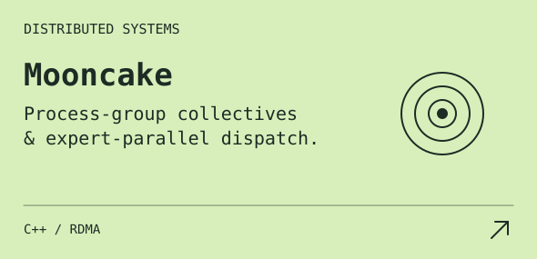</a>
  <a href="https://github.com/theraihanrakibb/nvfp4-dit">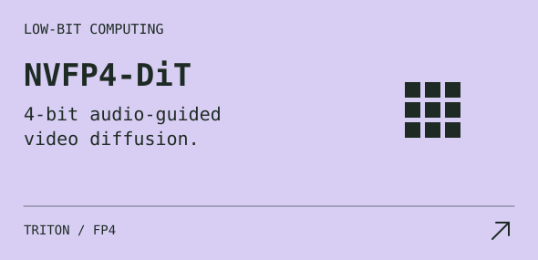</a>
  <a href="https://github.com/theraihanrakibb/ai-infra-portfolio">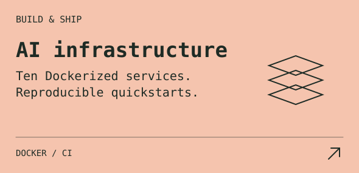</a>
  <a href="https://github.com/theraihanrakibb/deepfake-av-detector">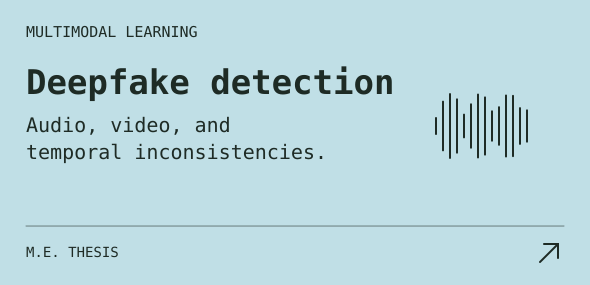</a>

## `Tech stack`

   
   
  

## `Research & experience`

  <a href="https://github.com/SJTU-ReArch-Group">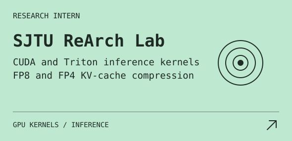</a>
  <a href="https://approaching-ai.com/en/">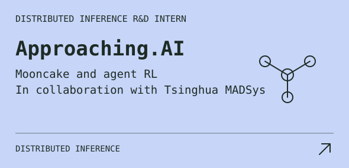</a>

<code>COLLABORATIONS</code>

  
  
  

## `Selected results`

  <a href="https://github.com/kvcache-ai/Mooncake">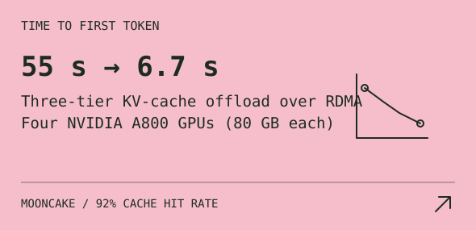</a>
  <a href="https://github.com/theraihanrakibb/nvfp4-dit">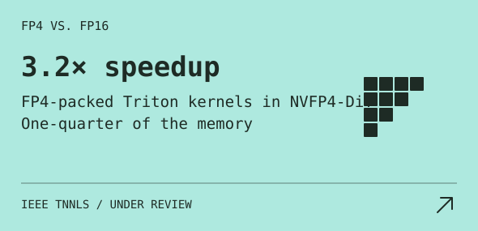</a>

## `Education`

  <a href="https://en.nwpu.edu.cn/">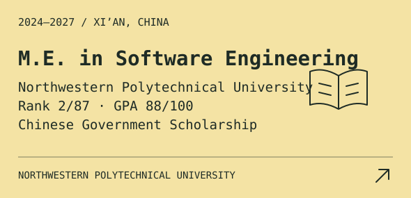</a>
  <a href="https://en.nwpu.edu.cn/">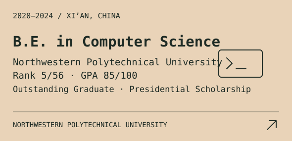</a>

---

## `More projects`

  
  
  
  

## `Activity`

  
  
  

<a href="https://github.com/theraihanrakibb#contribution-activity">
  <picture>
    <source media="(prefers-color-scheme: dark)" srcset="assets/studio/activity-dark.svg" />
    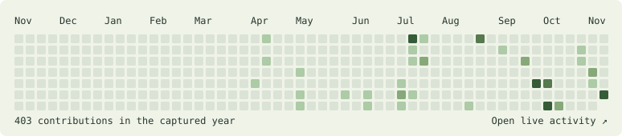
  </picture>
</a>
