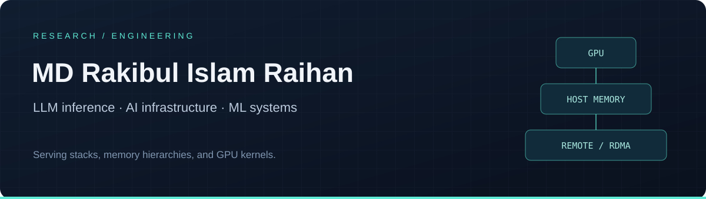

  

  <a href="https://theraihanrakibb.github.io/"><b>Portfolio</b></a>
  &nbsp; · &nbsp;
  <a href="https://linkedin.com/in/theraihanrakib"><b>LinkedIn</b></a>
  &nbsp; · &nbsp;
  <a href="mailto:raihanrakib.143@gmail.com"><b>Email</b></a>
  &nbsp; · &nbsp;
  <a href="Raihan_Research_Resume.pdf"><b>Research CV</b></a>
  &nbsp; · &nbsp;
  <a href="Raihan_Technical_Resume.pdf"><b>Technical CV</b></a>

 

## Making long-context agents cheaper to run

I work on **machine learning systems**, from LLM serving and KV-cache offloading to low-bit GPU kernels. My research connects disaggregated inference, RDMA, and memory management with the demands of agentic reinforcement learning.

> **8.3× lower time to first token** — from 55 s to 6.7 s, with a 92% KV-cache hit rate using three-tier offloading over Mooncake RDMA on 4× A800-80GB.

### Currently

**Research Intern · SJTU ReArch Lab**  
Low-bit inference kernels in CUDA and Triton, and FP8/FP4 KV-cache compression.  
November 2026 — present

**Large Model Inference Distributed System R&D Intern · Approaching.AI**  
Mooncake's C++ transfer engine, RDMA, and KV-cache offloading for agent RL rollouts, through a Tsinghua MADSys collaboration.  
November 2026 — present

 

## Selected work

### Mooncake · Distributed inference
Contributing process-group collectives and expert-parallel dispatch to **[kvcache-ai/Mooncake](https://github.com/kvcache-ai/Mooncake)**.

C++ &nbsp; / &nbsp; RDMA &nbsp; / &nbsp; Expert parallelism

---

### [NVFP4-DiT ↗](https://github.com/theraihanrakibb/nvfp4-dit)
**4-bit audio-guided video diffusion.** FP4-packed Triton kernels achieve 3.2× speedup over FP16 with 4× less memory. Submitted to IEEE TNNLS; under review.

Triton &nbsp; / &nbsp; FP4 &nbsp; / &nbsp; Video diffusion

---

### [AI Infrastructure Portfolio ↗](https://github.com/theraihanrakibb/ai-infra-portfolio)
Ten Dockerized AI infrastructure services, with CI and reproducible quickstarts.

Model serving &nbsp; / &nbsp; Docker &nbsp; / &nbsp; Infrastructure

---

### [Multimodal Deepfake Detection ↗](https://github.com/theraihanrakibb/deepfake-av-detector)
M.E. thesis: an audio-visual framework for detecting deepfake video through temporal inconsistencies.

Multimodal learning &nbsp; / &nbsp; Audio-visual detection

<b>More projects</b> — distributed training and confidential computing

 

- **[Distributed Training Launcher](https://github.com/theraihanrakibb/train-launcher)** — fault-tolerant multi-node PyTorch launcher with retries and checkpoint recovery.
- **[Confidential Spark Queries](https://github.com/theraihanrakibb/spark-ckks-query)** — B.E. thesis on distributed confidential queries using CKKS homomorphic encryption.

 

## Tools I work with

**Languages & kernels**  
Python · C++ · CUDA · Triton · PyTorch

**Inference & memory**  
SGLang · vLLM · Mooncake · RDMA · KV-cache offloading · Prefill/decode disaggregation · FP8/FP4

**Infrastructure & profiling**  
Linux · Docker · Kubernetes · NVIDIA Nsight

 

## Education

**Northwestern Polytechnical University** · Xi'an, China

**M.E. in Software Engineering** · 2024–2027  
GPA 88/100 · Rank 2/87 · Chinese Government Scholarship

**B.E. in Computer Science** · 2020–2024  
GPA 85/100 · Rank 5/56 · Outstanding Graduate · Presidential Scholarship

 

---

  <b>Interested in ML systems, inference, or GPU kernels?</b> 
  <a href="mailto:raihanrakib.143@gmail.com">Let's connect.</a>

