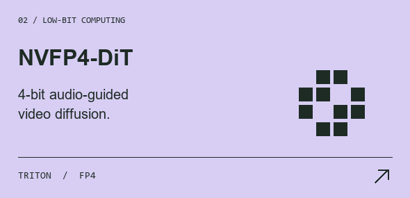

<picture>
  <source media="(prefers-color-scheme: dark)" srcset="assets/studio/hero-dark.gif" />
  <source media="(prefers-color-scheme: light)" srcset="assets/studio/hero-light.gif" />
  
</picture>

  <b>LLM inference &nbsp;·&nbsp; GPU kernels &nbsp;·&nbsp; Distributed systems</b>

  <a href="https://theraihanrakibb.github.io/">Portfolio</a> &nbsp; / &nbsp;
  <a href="https://linkedin.com/in/theraihanrakib">LinkedIn</a> &nbsp; / &nbsp;
  <a href="mailto:raihanrakib.143@gmail.com">Email</a> &nbsp; / &nbsp;
  <a href="Raihan_Research_Resume.pdf">Research CV</a> &nbsp; / &nbsp;
  <a href="Raihan_Technical_Resume.pdf">Technical CV</a>

 

SELECTED WORK — EXPLORE A PROJECT

  
  
  
  

  
  
  
  
  

<b>Behind the work</b> · research &amp; experience

My research connects disaggregated LLM serving, KV-cache offloading, and RDMA with the memory demands of agentic reinforcement learning. My goal is to make long-context agent rollouts cheaper and more scalable.

**Research Intern · SJTU ReArch Lab**  
November 2026–present. Low-bit CUDA/Triton inference kernels and FP8/FP4 KV-cache compression.

**Large Model Inference Distributed System R&D Intern · Approaching.AI**  
November 2026–present. Tsinghua MADSys collaboration: Mooncake's C++ transfer engine, RDMA, and KV-cache offloading for agent RL rollouts.

**Tools:** SGLang, vLLM, Mooncake, Linux, Docker, Kubernetes, NVIDIA Nsight.

<b>A closer look</b> · results &amp; more projects

**Inference:** 8.3× lower TTFT (55 s → 6.7 s), at 92% KV-cache hit rate with three-tier offload over Mooncake RDMA on 4× A800-80GB.

**NVFP4-DiT:** FP4-packed Triton kernels are 3.2× faster than FP16 and use 4× less memory. IEEE TNNLS, under review.

**[Distributed Training Launcher](https://github.com/theraihanrakibb/train-launcher):** fault-tolerant multi-node PyTorch launcher with retries and checkpoint recovery.

**[Confidential Spark Queries](https://github.com/theraihanrakibb/spark-ckks-query):** B.E. thesis on distributed confidential queries with CKKS homomorphic encryption.

<b>Background</b> · education

**Northwestern Polytechnical University · Xi'an, China**

**M.E. Software Engineering · 2024–2027**  
GPA 88/100 · Rank 2/87 · Chinese Government Scholarship.

**B.E. Computer Science · 2020–2024**  
GPA 85/100 · Rank 5/56 · Outstanding Graduate · Presidential Scholarship.

